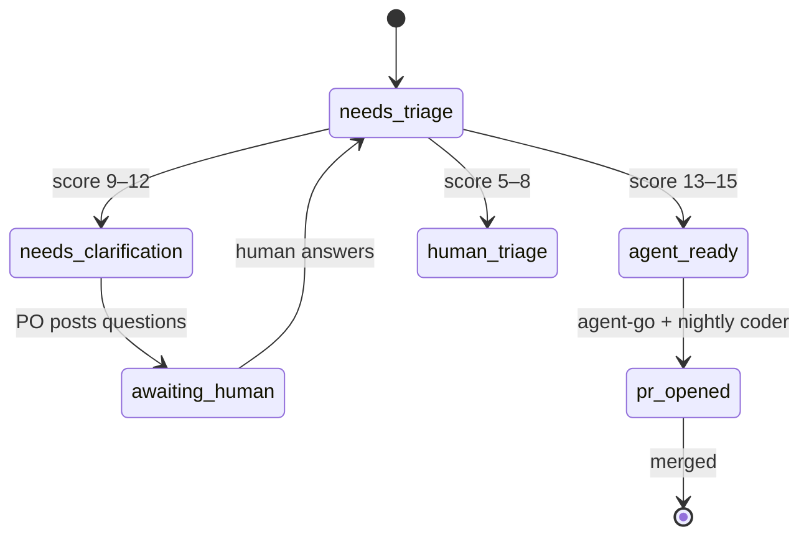

# Triagent — Design

A .NET 10 CLI that scans the open issues on a GitHub repository, scores each one for
how readily an AI coding agent could implement it, and stores the results in a local
SQLite database for incremental updates and querying.

The name is a portmanteau of *triage* and *agent*: it tells you which issues are
agent-ready, which need human triage first, and which should stay on a human's plate.

## Goals

- **Reduce manual triage** — surface the issues that are well-specified, bounded, and
  verifiable, so an agent can be pointed at them with minimal supervision.
- **Be incremental** — re-score only issues that are new or have changed since the
  last run. A full repo scan should be cheap on subsequent runs.
- **Be pluggable** — work with whichever LLM CLI is installed and authenticated
  (Claude Code or ChatGPT Codex initially).
- **Stay simple** — single binary, single SQLite file, no service to deploy.

## Scoring rubric

Each issue is scored 1–3 on five dimensions (higher = more agent-ready):

| Dimension          | 1                                  | 2                          | 3                                 |
| ------------------ | ---------------------------------- | -------------------------- | --------------------------------- |
| `specificity`      | Vague goal                         | Outcome implied            | Clearly defined outcome           |
| `containment`      | Cross-cutting                      | Moderate scope             | Self-contained                    |
| `verifiability`    | No clear success criteria          | Inferable                  | Explicit criteria or tests exist  |
| `clarity`          | Agent must make product decisions  | Some interpretation needed | Pure implementation               |
| `self_sufficiency` | Needs history/expertise to grok    | Some background helpful    | Fully understandable on its own   |

**Total score** = sum, range **5–15**.

- **13–15** — hand to an agent with confidence
- **9–12** — possible after a clarification pass
- **5–8** — needs human triage before any agent should touch it

## Tech stack

| Concern        | Choice                                                      |
| -------------- | ----------------------------------------------------------- |
| Runtime        | .NET 10 (single-project console app, AOT-friendly)          |
| CLI parsing    | `System.CommandLine`                                        |
| GitHub client  | `Octokit.NET` (handles pagination, auth, rate limits)       |
| LLM scorer     | Subprocess to `claude` or `codex` CLI (no API keys in env)  |
| Storage        | SQLite via `Microsoft.Data.Sqlite`                          |
| Output / TTY   | `Spectre.Console` (tables, progress bars)                   |

### Auth assumptions

- **GitHub** — uses `GITHUB_TOKEN` env var if set, otherwise falls back to
  `gh auth token`. No credentials handled by Triagent itself.
- **LLM CLIs** — assumes the chosen `claude` or `codex` binary is on `PATH` and
  already authenticated by the user.

## Pluggable scorer

A simple interface and two implementations:

```csharp
public interface IScorer
{
    string Name { get; }
    Task<IReadOnlyList<IssueScore>> ScoreBatchAsync(
        IReadOnlyList<IssueForScoring> batch,
        CancellationToken ct);
}
```

- `ClaudeCliScorer` — shells out to `claude -p <prompt> --model sonnet`
- `CodexCliScorer` — shells out to the ChatGPT Codex CLI with an equivalent prompt
- Both share a single `ScorePrompt.cs` containing the rubric prompt template.

The scorer is selected at runtime via `--scorer claude|codex` (default: `claude`).
Adding new scorers later (Gemini CLI, local model wrapper, the Anthropic SDK
directly) is a matter of dropping in another `IScorer` implementation.

## Data model (SQLite)

```sql
CREATE TABLE issues (
  repo                 TEXT NOT NULL,
  number               INTEGER NOT NULL,
  title                TEXT NOT NULL,
  url                  TEXT NOT NULL,
  labels               TEXT NOT NULL DEFAULT '',
  state                TEXT NOT NULL,            -- 'open' | 'closed'
  has_linked_pr        INTEGER NOT NULL DEFAULT 0,
  github_updated_at    TEXT NOT NULL,            -- ISO-8601 UTC
  closed_at            TEXT,                     -- set when archived
  last_scored_at       TEXT,                     -- null until scored
  scorer               TEXT,                     -- 'claude' | 'codex' etc.
  specificity          INTEGER,
  containment          INTEGER,
  verifiability        INTEGER,
  clarity              INTEGER,
  self_sufficiency     INTEGER,
  total                INTEGER,
  rationale            TEXT,
  PRIMARY KEY (repo, number)
);

CREATE INDEX idx_issues_total      ON issues(repo, state, total DESC);
CREATE INDEX idx_issues_state      ON issues(repo, state);
```

Default DB location: `~/.triagent/triagent.db`. Overridable with `--db <path>`.

## Incremental analyze flow

```
analyze --repo <owner/name> [--scorer claude|codex] [--force] [--batch-size 5]
```

1. **List open issues** via the GitHub issues API (paged, 100 per call). Each item
   already carries `updated_at` — no comments are fetched yet.
2. **Detect closures.** Any issue currently `state='open'` in our DB that does *not*
   appear in this listing is set to `state='closed'` with `closed_at = now`. We
   never delete rows — history is preserved for stats and re-analysis.
3. **Detect PR linkage.** For each open issue, check whether a PR references it
   (closes/fixes/resolves keyword in an open PR body, OR a `cross-referenced` event
   from a PR on the issue timeline). Triagent scans only an allowed repo scope:
   - the analyzed repo itself, plus
   - repo-scoped linked repos persisted in local DB (`repo_settings.linked_pr_repos`).

   Backward compatibility: when no repo-scoped mapping exists yet for a target
   repo, Triagent falls back to global `linkedPrRepos` config, then persists that
   value as the repo-scoped mapping for future runs.

   If linked, set `has_linked_pr=1` and skip scoring. Surface count in the run summary.
4. **Decide what to score.** An issue needs scoring when:
   - It is not yet in the DB, OR
   - `github_updated_at > last_scored_at`, OR
   - `--force` was passed.
   PR-linked issues are excluded regardless.
5. **Fetch comments** for the to-be-scored set (parallel, throttled).
6. **Batch and score.** Group into N (default 5) issues per scorer call. Upsert
   results back into the DB.
7. **Print summary.** `X scored, Y skipped (unchanged), Z newly closed, W skipped (PR linked).`

### Why archive instead of delete?

Closed issues stay in the DB so historical scores remain queryable (`stats --include-closed`,
`top --state closed`, etc.), and so re-opened issues do not need re-scoring if their
content hasn't changed.

## CLI surface

```
triagent analyze   <owner/repo> [--scorer claude|codex] [--force] [--batch-size N]
triagent top       [N=10] [--repo R] [--state open|closed|all] [--label L] [--min-score S]
triagent show      <number> [--repo R]
triagent stats     [--repo R] [--include-closed]
triagent export    [--repo R] [--format tsv|csv|json] [--output PATH]
triagent repos     -- list repos tracked in the DB
triagent linked-repos list   [--repo R]
triagent linked-repos set    [--repo R] <owner/repo>...
triagent linked-repos add    [--repo R] <owner/repo>...
triagent linked-repos remove [--repo R] <owner/repo>...
```

Default `--repo` can be set in a config file so day-to-day commands don't need it.

## Configuration

`~/.triagent/config.json` (auto-created on first run):

```json
{
  "defaultRepo": "getsentry/sentry-dotnet",
  "defaultScorer": "claude",
  "defaultModel": "sonnet",
  "batchSize": 5,
  "dbPath": "~/.triagent/triagent.db",
  "linkedPrRepos": [
    "getsentry/sentry-docs"
  ]
}
```

`linkedPrRepos` remains supported as a compatibility fallback/seed value. Effective
linked-repo mapping is stored per analyzed target repo in the local DB.

Example effective mapping:

- `getsentry/sentry-dotnet` -> [`getsentry/sentry-docs`]
- `owner/other-repo` -> []

Any setting can be overridden via CLI flags (except linked repo mapping, which is currently persisted and resolved automatically as described above).

## Project layout

```
src/Triagent/
  Program.cs                       -- composition root, CLI wiring
  Commands/
    AnalyzeCommand.cs
    TopCommand.cs
    ShowCommand.cs
    StatsCommand.cs
    ExportCommand.cs
    ReposCommand.cs
  GitHub/
    GitHubClient.cs                -- thin wrapper over Octokit
    PrLinkageDetector.cs           -- timeline + open-PR body scan
  Scoring/
    IScorer.cs
    ClaudeCliScorer.cs
    CodexCliScorer.cs
    ScorePrompt.cs                 -- shared rubric prompt
    BatchRunner.cs                 -- batching, retries, JSON parsing
  Data/
    IssueDb.cs                     -- SQLite open/migrate/upsert/query
    Migrations/001_init.sql
  Models/
    Issue.cs
    IssueScore.cs
    AnalyzeSummary.cs
  Config/
    TriagentConfig.cs
tests/Triagent.Tests/
  ...
DESIGN.md
README.md
.gitignore
LICENSE                            -- chosen later when made public
Triagent.sln
```

## Scaling to multiple agents (future direction)

Today Triagent does one job: score issues for agent-readiness. But the same
substrate — GitHub as the system of record, a local SQLite index, and a scheduled
sweep — generalises to a small team of role-playing LLM agents (a "product owner"
that asks clarifying questions, a "reviewer" that critiques PRs, later a "PM" or
"designer"). This section describes how the design scales in that direction
*without* rewriting what already exists. None of it is built yet; it exists to keep
today's decisions compatible with tomorrow's.

### Principle: a blackboard, not a group chat

The tempting model for "multiple LLMs working together" is agents that message each
other directly — a swarm passing a shared conversation around. That model grows
context without bound and is almost impossible to debug.

Triagent takes the opposite approach: **agents never talk to each other directly.**
GitHub is a shared *blackboard*. Each agent observes issue state, does one bounded
job, and mutates state (adds a label, posts a comment, opens a PR, assigns a human).
The next agent is triggered by that new state. This is a **state machine over the
issue**, not a conversation between processes.

Consequences:

- **Free audit trail and UI** — every decision is a comment or a label edit in a
  tool the maintainer already lives in.
- **Human-in-the-loop is a native primitive** — assignment, review-request, and
  `@mention` *are* the escalation mechanism; no bespoke approval UI is needed.
- **Bounded context** — no agent ever needs the whole history. It reconstructs
  "where are we" from the current label plus the last few comments.

### Issue lifecycle as a state machine

State lives in **labels**; rationale lives in **comments**. Each transition is a
small, stateless job.

```
needs-triage ──(scorer)──► agent-ready         (total 13–15)
                        ├─► needs-clarification (total 9–12)
                        └─► human-triage        (total 5–8)

needs-clarification ──(product-owner agent)──► posts questions,
                                               assigns human, sets awaiting-human
awaiting-human ──(human answers, clears label)──► needs-triage   (re-score; loop closes)

agent-ready + agent-go (human opt-in) ──(nightly coder)──► PR opened
PR opened ──(reviewer / designer agents)──► review comments
```



The `agent-go` label is the human opt-in that already drives the nightly PR run —
it stays a deliberate, maintainer-applied gate.

### Agents are stateless jobs, triggered two ways

Every role is a stateless invocation — `role(issue) → mutation` — not a long-lived
process. There is no "keep an agent running"; there is only "which state transition
fires which prompt." Two trigger types cover everything:

| Trigger        | Mechanism                                   | Good for                         |
| -------------- | ------------------------------------------- | -------------------------------- |
| Event-driven   | GitHub webhook / `repository_dispatch`      | Reactive, low-latency handoffs   |
| Scheduled sweep| Cron (already used for the nightly PR run)  | Batch or expensive work          |

### Roles as a pluggable interface

Roles mirror the existing `IScorer` pattern — a narrow interface with one
implementation per role, each backed by a prompt template and a *context recipe*
(see below). The scorer becomes just the first `IAgentRole`.

```csharp
public interface IAgentRole
{
    string Name { get; }                    // "scorer", "product-owner", "reviewer"
    string TriggerLabel { get; }            // state that activates this role

    Task<RoleResult> RunAsync(
        IssueContext context,               // scoped inputs, not the whole history
        CancellationToken ct);
}

// A role's only side effects are expressed as intents the dispatcher applies to
// GitHub — never direct cross-agent calls.
public sealed record RoleResult(
    IReadOnlyList<string> AddLabels,
    IReadOnlyList<string> RemoveLabels,
    string? Comment,
    string? AssignTo);                       // set to escalate to a human
```

A thin **dispatcher** maps trigger → role → apply-result-to-GitHub. This is a few
hundred lines inside the existing CLI; it does *not* require adopting a multi-agent
framework.

### Decision policy: when an agent escalates vs. acts

Whether an agent may "just run with it" is an explicit, encoded rule — not left to
the model's discretion per run. Two axes decide:

- **Product vs. implementation decision.** This is already the rubric's `clarity`
  dimension. Any agent that would need to make a *product* decision is forbidden
  from guessing; it must emit the question and escalate. Implementation decisions it
  makes autonomously.
- **Reversible vs. irreversible.** Reversible, implementation-space actions run
  autonomously. Irreversible or outward-facing actions (merging, closing issues,
  anything users see) require a human gate.

The gate is mechanical: the agent posts its reasoning, sets `assignTo` to the
maintainer, and applies `awaiting-human`. Being an assignee *is* being the decision
maker.

### Context management: retrieve, don't accumulate

The scaling risk is a context that drags the whole project history into every job.
Three rules prevent it:

1. **Each job pulls a scoped context recipe.** A coder needs the issue thread plus
   code retrieved live; a product-owner needs the issue thread plus related past
   decisions and design docs. Nobody loads everything. `IssueContext` above is built
   per role from a recipe, not from an ever-growing blob.
2. **Handoffs pass a pointer plus a distilled summary, not a transcript.** When the
   product-owner hands off to the coder, it writes a crisp "clarified spec" comment;
   the coder reads *that*, not the 40-message thread. Summarise-and-link.
3. **The one thing that legitimately grows — accumulated product decisions, ADRs,
   prior clarifications — lives in a searchable store, queried on demand.** This is
   the retrieval layer, scoped to *decisions and docs* (code is retrieved live at
   coding time). It needs no new infrastructure: SQLite already provides **FTS5**
   for full-text search, and **sqlite-vec** adds embeddings. A `memory` table beside
   `issues`, indexed for search, preserves the single-file, no-service-to-deploy
   ethos.

Sketch:

```sql
CREATE TABLE memory (
  id          INTEGER PRIMARY KEY,
  repo        TEXT NOT NULL,
  issue       INTEGER,               -- null for repo-wide docs/ADRs
  kind        TEXT NOT NULL,         -- 'decision' | 'clarification' | 'adr' | 'doc'
  content     TEXT NOT NULL,
  created_at  TEXT NOT NULL
);
CREATE VIRTUAL TABLE memory_fts USING fts5(content, content='memory', content_rowid='id');
```

### Build vs. buy

Three layers, with different answers:

| Layer                                   | Approach            | Notes                                                                 |
| --------------------------------------- | ------------------- | --------------------------------------------------------------------- |
| The coder (issue → PR)                  | **Buy**             | Already delegated to `claude`/`codex` CLIs; GitHub-native agents exist |
| Orchestration (state → prompt + context)| **Build thin**      | The dispatcher above; adopt LangGraph/Temporal only when workflows become long-running, resumable, and fan-out-heavy |
| Bus + memory                            | **Reuse**           | GitHub issues/labels/comments + the local SQLite index                |

Heavy orchestration or role frameworks (LangGraph, Temporal, CrewAI, AutoGen, the
OpenAI/Claude agent SDKs) earn their place only once a job must suspend for days
awaiting a human, resume, retry on failure, and fan out reliably. Until that pain is
felt, cron + webhooks + the dispatcher is enough, and it keeps the single-binary
ethos.

### Smallest next step

Add exactly one new role — the **product-owner clarifier** — because it closes a
loop the scorer already surfaces (the 9–12 "needs a clarification pass" band) and
exercises every mechanism above: a trigger, a context recipe, a state mutation, and
a human-escalation gate.

1. Auto-apply `needs-clarification` from the scorer for the 9–12 band.
2. A `triagent clarify` command runs a product-owner prompt that outputs *only*
   clarifying questions (never product decisions), posts them as a comment, and
   applies `awaiting-human`.
3. When the maintainer replies and clears `awaiting-human`, the next `analyze`
   re-scores — and issues climb from 9–12 into 13–15.

If that loop feels good, the same `(trigger, context recipe, mutation)` shape clones
into reviewer, designer, and PM roles later, with no rework — they are all just
transitions on the same blackboard.

## Out of scope (for now)

- Multi-user / hosted mode
- Web UI / dashboard
- Posting labels or comments back to GitHub (we may add `--apply-labels` later)
- Scoring PRs themselves
- Pricing/cost tracking per analyze run
- Built-in `--watch` mode — use cron for now (tracked in issue #1)
- Content-hash based re-scoring to skip label-only bumps (tracked in issue #2)

## Settled defaults

- **Private repos** — scored without any extra flag. If the user can see them via
  their GitHub token, Triagent treats them like any other repo.
- **Re-score trigger** — GitHub's `issue.updated_at` field. Simple and good enough;
  noisy label edits will trigger a re-score until issue #2 lands.
